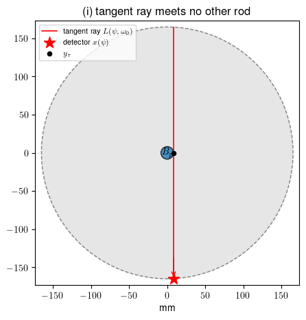
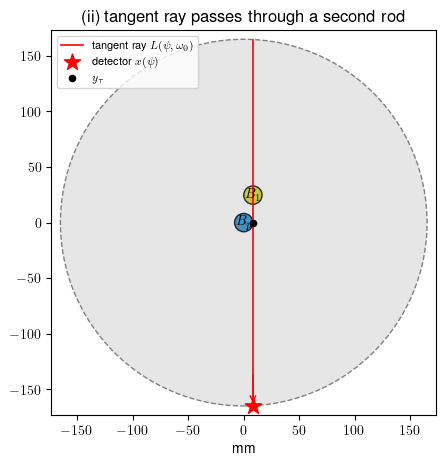
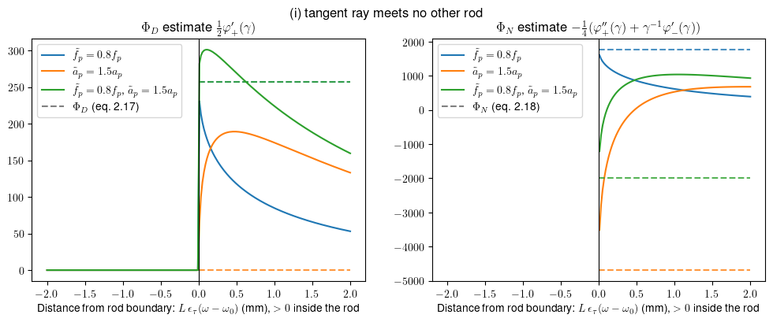

# Numerical attenuated Radon transform stability estimates
for
### SINGULAR STABILITY ESTIMATES FOR PASSIVE GAMMA EMISSION TOMOGRAPHY OF SPENT NUCLEAR FUEL (2026)
by T. Heikkilä, T. Helin, S. Holman, S. R. Jathar and J. Railo

Single ray stability estimates for different simple tangencies and perturbed rod values. 
The phantom is defined by disc centers and radii, and the pencil-beam data are computed in closed form: along a line the
coefficients are piecewise constant, so $R_a f$ is an exact sum over rod chords.

### Conventions 

- Lengths in mm, attenuation in 1/mm, angles in rad.

- Geometry and values are *almost* realistic.

- $\Omega = B(0, r_\mathrm{out})$ with moderator attenuation $a_0$ and no emission; rods $B_q = B(c_q, r)$ with constant $(a_q, f_q)$.
- The detector location $x(\psi) \in \partial\Omega$ is fixed and $\theta(\omega) = (\cos\omega, \sin\omega)$ is the ray direction towards the detector, so the *attenuated Radon transform* can be written as
  $$H(\omega) = R_a f\big(x(\psi), \theta(\omega)\big) = \int_0^\infty f\big(x(\psi) - s\theta(\omega)\big)\exp\Big(-\int_0^s a\big(x(\psi) - \sigma\theta(\omega)\big)\, d\sigma\Big)\, ds,$$
  i.e. with the backward ray from the detector.

### Experiments

- Numerically estimate angular derivatives in $\Phi_D[H]$ and $\Phi_N[H]$, where $H = R_a f - R_{\tilde a} \tilde f$. The input pair $(\tilde a, \tilde f)$ is different from a fixed reference pair $(a,f)$ only at a single rod $B_p$ by
    - Emission is 20% lower: $\tilde f_p = 0.8 f_p$.
    - Attenuation is 50% higher: $\tilde a_p = 1.5 a_p$.
    - Emission is 20% lower and attenuation is 50% higher: $\tilde f_p = 0.8 f_p, \tilde a_p = 1.5 a_p$.
- The ray is tangent to the rod $B_p$ and  
    (i) meets no other rods  
    (ii) passes through a second rod  

- For comparison the true limit values are computed since the phantom and geometry are known.

- From the numerical limits, the emission and attenuation values $\tilde f$ and $\tilde a$ are recovered via extrapolation at the tangency. These values are compared to the true values.
    - There is no noise in the data and we only consider recovery of a single rod.
